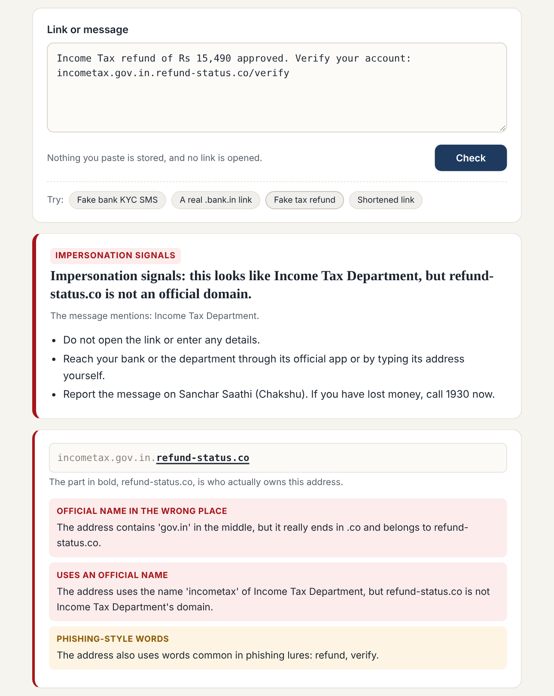
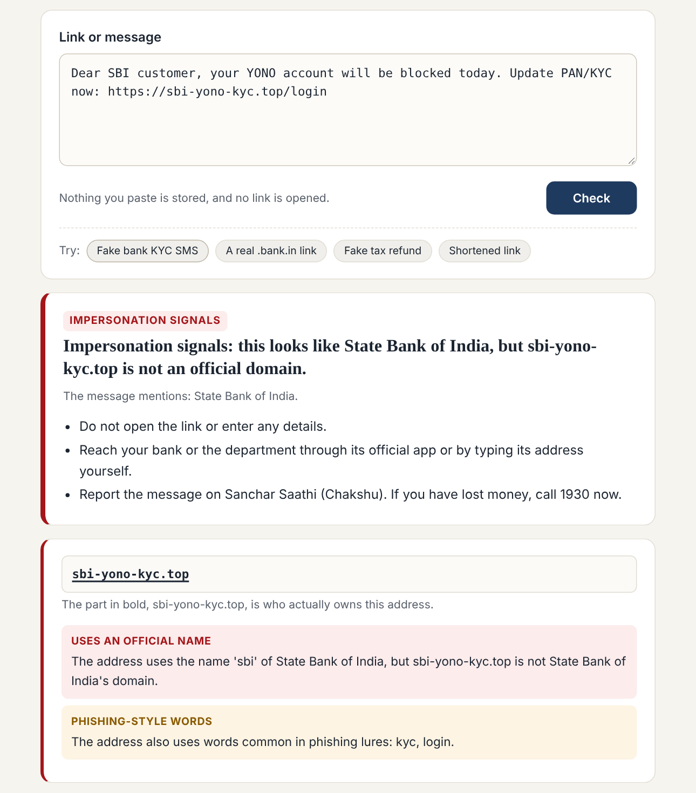
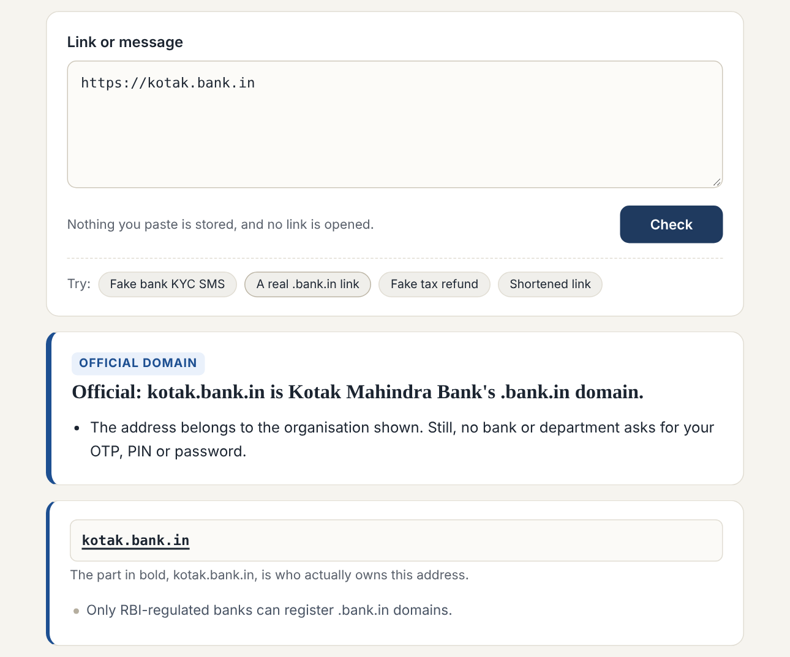
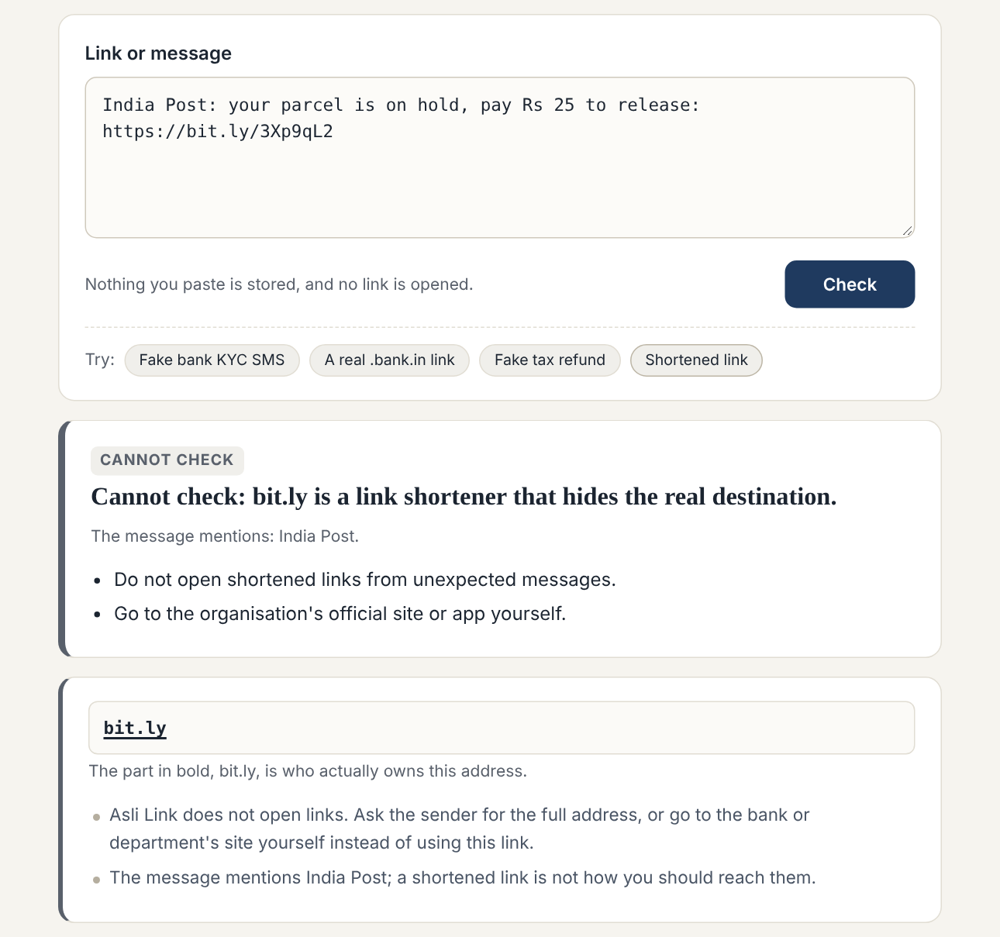

# Asli Link

**Is this link really your bank?** Asli Link checks whether a link belongs to the Indian bank or government office it
claims to be. It uses India's official namespaces (`.bank.in`, `.gov.in`, `.nic.in`) as trust anchors and explains
every answer.

[](https://github.com/shashankedu02/asli-link/actions/workflows/ci.yml)
[](LICENSE)



## Why

- **Fake bank, KYC, refund and government links are a main way money is stolen.** In 2025, Indians reported about
  ₹19,813 crore lost across 21.77 lakh cheating-related complaints on the National Cyber Crime Reporting Portal
  ([I4C data via IANS](https://ianslive.in/indians-lose-over-rs-52976-crore-to-cyber-frauds-over-six-years-report--20260103154943)).
- **There is now a trust anchor to check against.** RBI directed every bank to move its website to the restricted
  `.bank.in` domain by 31 October 2025, and only RBI-regulated banks can register there
  ([RBI circular RBI/2025-26/28](https://www.business-standard.com/finance/news/rbi-asks-banks-to-complete-migration-to-bank-in-domain-by-october-31-2025-125042201515_1.html)).
  More than 400 banks have migrated
  ([The Paypers](https://thepaypers.com/fraud-and-fincrime/news/over-400-indian-banks-migrate-to-bankin-domain)).
- **Existing checkers are reputation databases.** Tools such as Truecaller Scam Checker compare a link against reports.
  They can't explain *why* an address is or isn't a particular bank, and they know nothing about a domain registered an
  hour ago. Asli Link answers from the structure of the address itself, so it also works on brand-new domains.

## What it does

Paste a link or the whole SMS/WhatsApp message. Every link gets one of four verdicts:

| Verdict | Meaning |
|---|---|
| **Official** | The address is inside `.bank.in`, `.gov.in` or `.nic.in`, or is a curated official domain (for example a bank's older domain, or `rbi.org.in`). The bank or office is named where known. |
| **Impersonation signals** | Not official, but it imitates an official name. Each signal is shown with its evidence. |
| **Not recognised** | The default. No claim can be established either way. **This is not "safe".** |
| **Cannot check** | A link shortener hides the destination. Asli Link never opens links, so it doesn't find out. |

"Official" says who owns the address. It does not say a request is genuine: no bank or department asks for your OTP,
PIN or password by link, and official sites can be compromised. The interface uses blue, never green, for "official".

| Fake bank KYC SMS | Real `.bank.in` link | Shortened link |
|---|---|---|
|  |  |  |

## How it decides

1. **Find the real owner.** The registrable domain is computed with the
   [Public Suffix List](https://publicsuffix.org/) (vendored, MPL-2.0). `bank.in`, `gov.in` and `nic.in` are public
   suffixes, so `sbi.bank.in` and `hdfc.bank.in` are different owners, and in `sbi.bank.in.secure-login.xyz` the owner
   is `secure-login.xyz`.
2. **Check official namespaces and the curated registry** (`data/registry/entities.json`).
3. **Look for impersonation signals:**

| Signal | Example |
|---|---|
| `deceptive_suffix`: an official namespace in the wrong place | `incometax.gov.in.refund-status.co` |
| `namespace_lookalike`: a fake namespace | `hdfc-bank-in.com` |
| `brand_token`: an official name inside someone else's domain | `sbi-yono-kyc.top` |
| `lookalike_label`: a typosquat or visual lookalike of an official domain | `onlinesbl.com`, `iclcibank.com` |
| `mixed_script`: mixed alphabets (homoglyphs) | `аxisbank.com` with a Cyrillic `а` |
| `userinfo_trick`: the real host hidden after `@` | `https://sbi.bank.in@evil.example` |
| `claim_mismatch`: the message names a bank or office, but the link goes elsewhere | "Your HDFC card is blocked: https://random-shop.in" |

Phishing-style words (`kyc`, `verify`, `refund`, …) are reported as extra evidence, never as a verdict on their own.
Full rules and design decisions: [docs/RULES.md](docs/RULES.md).

## Run it

Requires Python 3.11+.

```bash
python -m venv .venv
# Windows: .venv\Scripts\activate    macOS/Linux: source .venv/bin/activate
pip install -r requirements.txt
uvicorn server.app:app --port 8000
```

Open <http://127.0.0.1:8000>. API documentation is at <http://127.0.0.1:8000/docs>.

```bash
curl -s -X POST http://127.0.0.1:8000/api/check \
  -H "Content-Type: application/json" \
  -d '{"text": "Dear SBI customer, update KYC: https://sbi-yono-kyc.top/login"}'
```

| Endpoint | Purpose |
|---|---|
| `POST /api/check` | `{"text": "..."}` (≤ 5,000 characters, ≤ 20 links) → verdict, evidence and notes per link |
| `GET /api/registry` | Registry version, SHA-256, namespaces and curated entities |
| `GET /api/health` | Liveness and registry version |

## Tests

```bash
pip install -r requirements-dev.txt
ruff check . && pytest -v
```

The suite covers:
- domain parsing traps;
- every signal, with positive and negative cases (unrelated domains must stay *Not recognised*);
- registry fail-closed loading (a malformed registry stops the app instead of answering);
- the API contract, security headers, and that pasted text is never logged.

CI runs lint, the suite on Python 3.11 and 3.13, and a live start-up check of the server.

## Data and provenance

- **`data/psl/`:** Public Suffix List snapshot, with its MPL-2.0 licence.
- **`data/registry/entities.json`:** curated banks, government brands and institutions, with official domains, brand
  tokens and message aliases. Tokens and aliases can only *raise* signals; they never make a domain official.
  - `.bank.in` entries are listed only where the domain was confirmed.
  - Any `.bank.in` domain is still treated as official through the namespace rule.
- **`data/registry/observed_bank_in.json`** (when present): every registrable `.bank.in` domain seen in public
  Certificate Transparency logs. It is built by `scripts/build_observed_bank_in.py` through the manually triggered
  *Refresh .bank.in snapshot* workflow.

## Limitations

- It checks addresses, not page content. A compromised official site, or a phishing page on a free hosting service
  with no brand in the address, will not be flagged.
- The curated list is small. A bank, department or company missing from it gets *Not recognised*, never *fake*.
  Government brands are recognised only through `.gov.in` / `.nic.in`; agencies on other domains need curation.
- Brand-token matching is precision-first. Names of 3 letters or fewer (`sbi`, `pnb`, `rbi`) match only as a separate
  word (`sbi-kyc.top`, not `sbikyc.top`); longer tokens (`yono`, `onlinesbi`) cover the joined-up forms.
- Bare addresses without `http(s)://` are recognised only when written in lower case or with `www.`. This is
  deliberate: "customer.Click" in a message is usually a missing space, not a link.
- Shortened links are not expanded, because expanding one contacts the sender's server.
- English messages only, for now.
- No accuracy figures are claimed yet. A labelled evaluation is planned (see roadmap).

## Roadmap

- [ ] Live impostor monitor: watch Certificate Transparency logs for newly certified domains that imitate Indian banks
      and government services, with an analyst view and export.
- [ ] Evaluation: precision on a labelled sample of monitor output; recall on known Indian-brand phishing URLs from
      public feeds. Raw labels committed.
- [ ] Expand the curated registry (all scheduled banks, more departments), each entry with a source.
- [ ] Hindi and Kannada message support.
- [ ] Public deployment.

## Privacy and ethics

- Pasted text is processed in memory. It is never stored or logged, and the server makes no outbound requests.
- The interface loads nothing from other origins and is served with a strict Content Security Policy.
- The registry builder reads only public Certificate Transparency data.
- Asli Link is an independent student project, not affiliated with RBI, NPCI, IDRBT or any bank or government body.
- If you have lost money, call **1930** or report at [cybercrime.gov.in](https://cybercrime.gov.in). To report a fraud
  message, use [Sanchar Saathi (Chakshu)](https://sancharsaathi.gov.in).

## License

Code: [MIT](LICENSE). Public Suffix List data: [MPL-2.0](data/psl/LICENSE).
